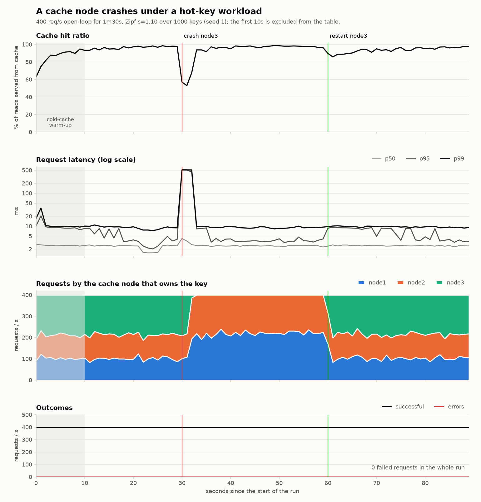

# cachekit — a distributed cache with consistent hashing

A from-scratch distributed in-memory cache in Go. Keys are spread over cache
nodes with a **consistent-hash ring (virtual nodes)**, nodes speak a **Redis-
compatible protocol (RESP subset)** over raw TCP, and a **coordinator** detects
dead nodes by heartbeat and publishes a versioned ring that clients follow.
The cache itself has no external Go dependencies; only the demo app uses one
(the `pgx` PostgreSQL driver).

```
                       heartbeats / ring (HTTP+JSON)
   Nodes (RESP/TCP) ───────────────►  Coordinator  ◄──── long-poll /ring ────┐
     ▲   ▲   ▲                                                               │
     └───┴───┴──── GET/SET/DEL (RESP) ─── Client library (local ring copy) ──┘
                                              ▲
                                       your app / cachectl
```

Key lookups happen **inside the client** with a local copy of the ring, so no
request pays an extra network hop. The coordinator is control plane only.

## Layout

| Path | What it is |
|---|---|
| `ring/` | Consistent-hash ring + vnodes + XXH64. Pure logic, no I/O. |
| `store/` | LRU + TTL in-memory store (one per node). |
| `resp/` | RESP reader/writer (the wire protocol). |
| `server/` | TCP server for one node; implements the commands. |
| `cluster/` | Types shared by coordinator and client (membership, events). |
| `coordinator/` | Heartbeats, failure detection, versioned membership, HTTP API. |
| `node/` | A node's lifecycle: store + server + heartbeat loop. |
| `client/` | Pooled client with local ring; follows the coordinator. |
| `flight/` | Single-flight: concurrent loads of the same key share one database call. |
| `catalog/` | Demo domain: products, cache-aside `Service`, Postgres and in-memory repositories. |
| `api/` | Demo HTTP/JSON API over `catalog.Service`. |
| `cmd/node`, `cmd/coordinator` | The two server programs. |
| `cmd/demo` | The product-catalog demo app (HTTP API + PostgreSQL + the cache). |
| `loadtest/`, `cmd/loadgen` | Hot-key (Zipf) open-loop load generator with scheduled node crashes; per-second CSVs and a summary table. |
| `cmd/cachectl` | CLI to poke a cluster (`status`, `get`, `set`, `fill`, `check`...). |
| `cmd/experiment` | Produces the report graphs' data (remap % and load balance). |
| `deploy/` | Dockerfile + docker-compose (coordinator, 3 nodes, Postgres, demo app). |
| `docs/` | `DESIGN.md` (decisions, trade-offs, interview Q&A), results + plot script. |

## Run the tests

```powershell
go vet ./...
go test ./...
```

`-race` needs a C compiler on Windows (cgo), so it is optional there:
`go test -race ./...` works on Linux/macOS/WSL.

## Run a cluster (no Docker) — 4 terminals, in the project folder

```powershell
go build -o bin/ ./cmd/...
```
```powershell
.\bin\coordinator.exe                                                       # terminal 1
.\bin\node.exe -id node-1 -listen :7001 -coordinator http://localhost:8080  # terminal 2
.\bin\node.exe -id node-2 -listen :7002 -coordinator http://localhost:8080  # terminal 3
.\bin\node.exe -id node-3 -listen :7003 -coordinator http://localhost:8080  # terminal 4
```
(Windows Firewall may ask once: allow on private networks.)

Then in a 5th terminal:

```powershell
.\bin\cachectl.exe status          # 3 nodes, ring share per node
.\bin\cachectl.exe fill 10000      # spreads 10000 keys, prints keys per node
.\bin\cachectl.exe check 10000     # 100% hits
.\bin\cachectl.exe set hello world 30s
.\bin\cachectl.exe get hello
.\bin\cachectl.exe owner hello
```

**Failover demo**

1. Close the **terminal window** of node-2 (or kill its process). This is a *crash*: no goodbye.
2. `.\bin\cachectl.exe check 10000` right away: about a third of requests report *errors* (node unreachable, the coordinator has not noticed yet).
3. Wait ~3 seconds, run `check` again: **0 errors**, hits drop to about 2/3 (node-2's keys are gone), and the keys on node-1/node-3 are untouched — that is the consistent-hashing result.
4. Start node-2 again (even on another port, same `-id node-2`): it gets its ring positions back. `status` shows it alive.
5. Press **Ctrl+C** in node-3's terminal instead: that is a *graceful* leave and is picked up immediately.

`.\bin\cachectl.exe status` always shows who is alive and how much of the ring each node owns.

## Redis tools without installing Redis

Nodes speak RESP, so the real Redis tools work. Using the official image from Docker Desktop (nothing to install):

```powershell
docker run --rm redis:7 redis-cli -h host.docker.internal -p 7001 ping
docker run --rm redis:7 redis-cli -h host.docker.internal -p 7001 set foo bar ex 100
docker run --rm redis:7 redis-benchmark -h host.docker.internal -p 7001 -t set,get -n 100000 -q
docker run --rm redis:7 redis-benchmark -h host.docker.internal -p 7001 -t set,get -n 100000 -P 16 -q
```

This talks to a **single node**; `redis-cli` does not know about the ring.

## Run with Docker Compose

```powershell
docker compose -f deploy/docker-compose.yml up --build
docker compose -f deploy/docker-compose.yml run --rm cachectl status
docker compose -f deploy/docker-compose.yml run --rm cachectl fill 10000
docker stop cachekit-node2-1                      # crash a node
docker compose -f deploy/docker-compose.yml run --rm cachectl check 10000
docker start cachekit-node2-1                     # bring it back
```
Container names can differ slightly by Docker version; `docker ps` shows them.
`cachectl` runs inside the compose network because nodes advertise `node1:7001`
etc., which only resolves there. From the host, `curl http://localhost:8080/status`
shows the cluster and nodes are also published on ports 7001–7003.

## Demo app: product catalog with cache-aside (Docker + PostgreSQL)

A small REST API whose reads go **cache → database**. It shows what the cache is
for, and what happens to an application when a cache node dies.

**One-time setup** (the demo needs the `pgx` driver, so fetch it and create `go.sum`):

```powershell
cd P:\Distributed-Cache-Project
go mod tidy
go vet ./...
go test ./...
```

**Run everything** (coordinator, 3 cache nodes, PostgreSQL with 1000 seeded
products, the demo API):

```powershell
docker compose -f deploy/docker-compose.yml up --build
```

**Try it** (`curl.exe` on Windows PowerShell; plain `curl` is an alias for something else):

```powershell
curl.exe -i http://localhost:9090/products/42        # X-Cache: MISS, X-Cache-Node: nodeN
curl.exe -i http://localhost:9090/products/42        # X-Cache: HIT  (same node)
curl.exe -i http://localhost:9090/products/99999     # 404, MISS
curl.exe -i http://localhost:9090/products/99999     # 404, HIT (negative caching)
curl.exe "http://localhost:9090/products?limit=5&offset=10"
curl.exe -i -X PUT http://localhost:9090/products/42 -H "Content-Type: application/json" -d "{\"name\":\"Renamed\",\"price_cents\":999,\"stock\":5}"
curl.exe -i http://localhost:9090/products/42        # MISS again: the write invalidated the cache, then HIT
curl.exe http://localhost:9090/stats                 # hits, misses, db_reads, hit_ratio, ring
```

**Kill a cache node while the app is running:**

```powershell
curl.exe -i http://localhost:9090/products/42        # note X-Cache-Node, e.g. node2
docker stop cachekit-node2-1                         # (use the node the header named)
curl.exe -i http://localhost:9090/products/42        # still 200: X-Cache: MISS, served from PostgreSQL
# ~3 s later the coordinator drops the node and its keys re-home on the survivors:
curl.exe -i http://localhost:9090/products/42        # MISS on the new node...
curl.exe -i http://localhost:9090/products/42        # ...then HIT
docker start cachekit-node2-1                        # node returns; its key range comes back (cold)
```

PostgreSQL is also published on `localhost:5433` (user/password/db: `cachekit` /
`cachekit` / `catalog`) if you want to look at the data with `psql` or a GUI.
`docker compose ... down` discards the data (no volume), which resets the seed.

**No Docker, no database** (in-memory products), against the no-Docker cluster
from the section above:

```powershell
go run ./cmd/demo -store memory -coordinator http://localhost:8080   # with the cache
go run ./cmd/demo -store memory                                      # no cache: baseline
```

Useful flags: `-cache-ttl`, `-negative-ttl`, `-op-timeout`, and
`-simulate-db-latency 5ms` (adds delay to every database call: a localhost
Postgres answers in ~1 ms, which hides the benefit of a cache; label any numbers
measured this way as simulated latency).

## Load test: a hot-key workload and a cache-node crash

`cmd/loadgen` drives the demo API the way real cache traffic looks and records
what the *application* experienced, second by second: hit ratio, latency
percentiles, errors, and which cache node owned each requested key.

- **Hot keys.** Product ids are drawn from a Zipf distribution (exponent 1.1 over
  the 1000 seeded products): a handful of products get a large share of all reads
  (in a default run the 10 hottest receive about half), which is what makes a
  cache worth having and makes losing a node interesting.
- **Open-loop load.** Requests go out on a fixed schedule (default 400/s) no matter
  how slowly the server answers, and each latency is measured from the moment the
  request was *scheduled*. A closed loop (each worker waits for its response)
  silently lowers the load exactly when the server struggles and hides the spike.
- **Scheduled events.** `-event "<offset>|<label>|<command>"` runs a command at a
  chosen second (`docker kill ...`, `docker start ...`) and draws it on the graph.
- **Simulated database latency.** A Postgres on localhost answers in about a
  millisecond, which hides what a cache is for. `DB_LATENCY=5ms` adds a 5 ms delay
  to every database call, standing in for a database on another machine. Every
  number below is labelled as measured with it.

**Run it** (PowerShell, in the project folder). Build the tools once (running from
`bin\` also avoids Windows blocking freshly compiled temp executables):

```powershell
go build -o bin\loadgen.exe .\cmd\loadgen
pip install matplotlib
```

Start the stack with simulated database latency, plus the no-cache twin of the app
(port 9091, same database, used as the baseline):

```powershell
$env:DB_LATENCY = "5ms"
docker compose -f deploy/docker-compose.yml --profile bench up -d --build
```

**1. With vs. without the cache** (steady state, 40 s each; the freshly started cache is
cold, so the first 10 s, while it fills, are excluded from the table but still plotted):

```powershell
.\bin\loadgen.exe -url http://127.0.0.1:9091 -duration 40s -rate 500 -out docs/results/nocache
.\bin\loadgen.exe -url http://127.0.0.1:9090 -duration 40s -rate 500 -out docs/results/cached
```

**2. Crash a cache node under load, then bring it back.** The cache starts cold, so
restart the nodes first. Under the default seed, `node3` owns the largest share of
the traffic (about 47% in a reference run), so killing it shows the effect clearly;
a node that owns about a quarter of the traffic shows a smaller dip.

```powershell
docker compose -f deploy/docker-compose.yml restart node1 node2 node3
Start-Sleep 5                                                              # let the ring settle
.\bin\loadgen.exe -url http://127.0.0.1:9090 -duration 90s -rate 400 -out docs/results/failure `
    -event "30s|crash node3|docker kill cachekit-node3-1" `
    -event "60s|restart node3|docker start cachekit-node3-1"
python docs/plot_failure.py docs/results/failure
```

`docker kill` is a hard crash (SIGKILL): the node never tells the coordinator, so
the cluster only notices when heartbeats stop. (`docker stop` is a graceful leave
and would hide the detection window.) Each run writes `timeseries.csv`,
`nodes.csv`, `events.csv` and `summary.md` (a README-ready table plus a one-line
"dip and recovery" per event); `plot_failure.py` adds `failure.png`.

**Results** (one reference run on a Windows laptop with Docker Desktop; 3 cache nodes, PostgreSQL with **5 ms simulated database latency**, load generator on the same machine):

*With vs. without the cache* (500 req/s for 40 s, first 10 s excluded):

| | Hit ratio | p50 | p95 | p99 | Database reads per 1000 requests | Errors |
|---|---:|---:|---:|---:|---:|---:|
| No cache | n/a | 8.1 ms | 9.0 ms | 10.2 ms | 908 | 0 |
| With cache | 98.0% | 2.4 ms | 3.3 ms | 9.0 ms | 48 | 0 |

The cache cut database reads by about 95% and median latency by about 70%. (No-cache reads are
slightly under 1000 because concurrent reads of the same hot key share one database load.)

*Crash of the busiest cache node* (`node3`, which owns about 47% of requests; hard kill at 30 s, restart at 60 s; 400 req/s for 90 s, first 10 s excluded):

| Phase | Window | Hit ratio | p50 | p95 | p99 | Max | Errors |
|---|---|---:|---:|---:|---:|---:|---:|
| before the crash | 10–30 s | 96.3% | 2.4 ms | 4.1 ms | 9.5 ms | 15.8 ms | 0 |
| after the crash (includes refill) | 30–60 s | 93.2% | 2.6 ms | 9.1 ms | 508.9 ms | 521.9 ms | 0 |
| after the restart | 60–90 s | 93.8% | 2.5 ms | 8.5 ms | 9.7 ms | 12.1 ms | 0 |

- **No request failed**, including during the crash: about 36,000 requests in the run.
- **Crash:** the hit ratio fell to 53% in the worst second and was back within 5 points of normal after **3 s**
  (the coordinator's 3 s heartbeat timeout, then the dead node's keys re-homed on the survivors).
- **Restart:** a smaller dip, to 86%, back to normal in **6 s** while the returning node refilled its empty cache.
- **The cost of a crash is latency, not errors.** The crash window's p99 rose to about 509 ms. That matches two
  250 ms cache timeouts per request (the failed `GET`, then the failed `SET`) for keys that still route to the dead
  node until the coordinator removes it. The next section removes most of that.




**How to read the graph.** Top to bottom: the hit ratio; request latency (p50 / p95 /
p99, log scale); requests by the cache node that owns the key (traffic moving off
the dead node and back); and request outcomes. Vertical lines mark the crash and
the restart; the grey band is the cold-cache warm-up.

**What to expect, and why:**
1. *Crash.* Reads for the dead node's keys fall back to PostgreSQL, so the hit
   ratio drops immediately and **no request fails**. Until the coordinator's
   heartbeat timeout (3 s) passes, the client still routes those keys to the dead node.
2. *Re-homing.* The coordinator drops the node and bumps the ring version; the
   client picks it up by long-poll, and the dead node's keys spread over the
   survivors (only those keys move). The first read of each moved key is a miss that
   refills the cache, so the hot keys come back within seconds and the tail refills
   as it is requested.
3. *Restart.* The node rejoins with the same ID, so it gets its old key ranges
   back, with an empty cache: a second, smaller dip while it refills.

Caveats, stated plainly: the load generator, the app and Docker all share one
laptop, so absolute numbers say little and relative ones say more; the database
latency is simulated; one run is not a distribution (repeat it and report the
spread before quoting a number).

### Fixing the crash-window latency: a per-node circuit breaker

The measurement above exposed a real flaw: for the ~3 s before the coordinator evicts a dead node, every request for
that node's keys waited out a full cache timeout, and then waited out a second one when the app tried to refill the
cache. Two changes fix it:

- **The app no longer writes to a cache node whose read just failed** (`catalog.Service`): the write would only cost a
  second timeout. This halves the spike on its own.
- **The client has a per-node circuit breaker** (`client/breaker.go`). After 3 consecutive transport failures it stops
  calling that node and fails instantly (`ErrCircuitOpen`, still a `*NodeError`, so the app falls back to the
  database at once). After a 1 s cooldown it lets exactly one probe call through: success closes the breaker,
  failure re-opens it. Error replies from a live node never trip it. By the time the coordinator evicts the node the
  breaker has already absorbed the failure; if the node comes back, the next probe closes the breaker.

Re-run the crash test with the breaker off and on. `BREAKER_THRESHOLD=0` disables it (compose passes it to the demo):

```powershell
# A: breaker OFF (only the "no refill after a failed read" fix)
$env:DB_LATENCY = "5ms"; $env:BREAKER_THRESHOLD = "0"
docker compose -f deploy/docker-compose.yml up -d --build --force-recreate
docker compose -f deploy/docker-compose.yml restart node1 node2 node3; Start-Sleep 5
.\bin\loadgen.exe -url http://127.0.0.1:9090 -duration 90s -rate 400 -out docs/results/failure-nobreaker `
    -event "30s|crash node3|docker kill cachekit-node3-1" `
    -event "60s|restart node3|docker start cachekit-node3-1"

# B: breaker ON (the default)
$env:BREAKER_THRESHOLD = "3"
docker compose -f deploy/docker-compose.yml up -d --force-recreate demo
docker compose -f deploy/docker-compose.yml restart node1 node2 node3; Start-Sleep 5
.\bin\loadgen.exe -url http://127.0.0.1:9090 -duration 90s -rate 400 -out docs/results/failure-breaker `
    -event "30s|crash node3|docker kill cachekit-node3-1" `
    -event "60s|restart node3|docker start cachekit-node3-1"
python docs/plot_failure.py docs/results/failure-breaker
```

Measured results (Docker, 3 cache nodes, 400 req/s open-loop, Zipf 1.1, 5 ms simulated DB latency, `docker kill` of node3 at 30 s). Both runs used the no-refill-after-failed-read change; only the breaker differs:

| Run | Window | p50 ms | p95 ms | p99 ms | Max ms | Errors |
|---|---|---:|---:|---:|---:|---:|
| A: breaker off | 30-60 s (after crash) | 2.5 | 9.0 | **259.1** | 287.5 | 0 |
| B: breaker on | 30-60 s (after crash) | 2.6 | 8.5 | **9.9** | 259.4 | 0 |

The crash-window p99 drops from 259 ms to 9.9 ms (about 26x), back to the pre-crash level (9.4-9.6 ms). Before either fix, the same test showed a p99 of 509 ms (two 250 ms timeouts per request: the failed read, then the failed refill). The max stays near 250 ms in both runs because the first few requests must still hit the timeout to trip the breaker. The worst-second hit ratio is 53% in both runs: the breaker removes the latency cost of the dead node, not the cache misses for its keys. Raw data: `docs/results/failure-nobreaker` and `docs/results/failure-breaker`.

## Reproduce the headline graphs

```powershell
go run ./cmd/experiment -out docs/results
pip install matplotlib
python docs/plot_results.py docs/results
```
Writes `remap.csv/png` (keys moved when a node is added: consistent hashing vs
`hash % N`) and `balance.csv/png` (load imbalance vs number of vnodes). Results
from a reference run are already in `docs/results/`.

## Coordinator HTTP API

`POST /heartbeat`, `POST /deregister`, `GET /ring` (add `?since=V&epoch=E&wait=10s`
to long-poll), `GET /status`, `GET /events`, `GET /healthz`.

## Status vs. the roadmap

Done: ring (phase 1), store (2), RESP server (3), client (4), coordinator (5),
Docker Compose cluster, the two experiments, `redis-benchmark` compatibility,
and the cache-aside demo app (Postgres + HTTP API).
The load generator with failure graphs (see above).
Not built yet: dashboard.
Not built yet: the PostgreSQL cache-aside demo app (phase 6), the Zipfian load
generator and failure-injection graphs (7), the web dashboard (8).
